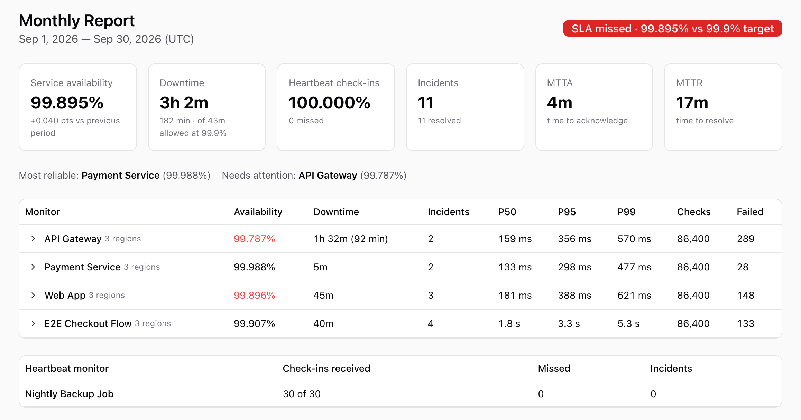

# Uptime reports: did we keep our promise, and if not, why?

<a href="https://www.upti.my/uptime-reports?utm_source=github&utm_medium=release&utm_campaign=reports">
  <picture>
    <source media="(prefers-color-scheme: dark)" srcset="https://raw.githubusercontent.com/uptimy/uptimy/main/releases/assets/2026.10.14-report-dark.png">
    
  </picture>
</a>

Every reliability promise comes with a question sooner or later. Your team asks whether you met the SLO this month. A prospect asks how reliable you are. A client wants their monthly report. Their auditor wants to know where the number came from.

Reports in Uptimy answer each of these from the same data: availability against your target for any period, the downtime that counted, the incidents behind it, and how each monitor performed.

**[See how reports work →](https://www.upti.my/uptime-reports?utm_source=github&utm_medium=release&utm_campaign=reports)**

## Close the month without doing math

Open Reports, pick the last 30 days, the month or the quarter, and the verdict is at the top: **met or missed** against your SLA target, how much of the allowed downtime you used, and how it compares with the period before.

Then find what hurt it:

- **Incidents, longest first,** with their cause (timeout, DNS, TLS, 5xx, failed assertion) and the regions that failed, each linking to its timeline
- **Downtime by cause,** time to acknowledge and time to resolve
- **p50 / p95 / p99 response times** per monitor and region, with a daily p95 chart, so a service that got slow without going down doesn't hide
- **Slow days:** set a p95 limit and see which days each monitor and region went over it

Export to CSV for the postmortem.

## Answer "how reliable are you?" with a link

When a customer or prospect asks, choose the monitors they care about, keep internal ones out, and create a share link. It shows the full report, never links into your workspace, can expire after 7, 30 or 90 days, and can be revoked once you don't need it. **Print / Save as PDF** gives them a clean A4 document.

The link keeps the monitors and SLA target it was created with, so a monitor you add later never shows up on a link you already sent.

## Send every client their report, without assembling it

Set it up once per client:

- **Their monitors,** websites, APIs and heartbeats, picked by search or tag
- **Their SLA target** from the contract, 99% to 99.99%
- **Their schedule:** weekly, monthly or quarterly, on the day and time you choose, in their timezone
- **Their recipients,** each emailed separately, with your own address added for a copy
- **Their logo, name and accent color** on the email and the shared page. With white-label, Uptimy's logo and footer are removed.

Each period is **frozen when it closes**, so the report a client received is the one they'll see later. The delivery log shows what was sent to whom, and a failed delivery can be resent.

## Numbers that hold up to review

A report is only useful if the reader trusts it, so every report states how it was calculated:

- **Uptime is measured by time,** not by the share of passed checks, so changing a check interval doesn't change the number and short outages don't disappear.
- **Downtime starts at the first failed check,** confirmed by a majority of the monitor's regions. One region's blip isn't an outage.
- **Planned maintenance isn't downtime** from the moment the window existed. A window added after the work started is marked on the report, and the time before it still counts.
- **A monitor added mid-month counts from its creation,** and a deleted monitor stays on past reports, marked deleted.

The evidence is there too: CSV per monitor, per day, per incident and per maintenance window, and the same reports through the API:

```bash
uptimyctl reports get --quarter 2026-Q3
uptimyctl reports get --month 2026-09 --report Acme --csv incidents > acme-incidents.csv
```

Reports are also in [uptimyctl](https://github.com/uptimy/uptimyctl) 1.6.1 and the [MCP server](https://www.upti.my/docs/mcp?utm_source=github&utm_medium=release), so you can ask your assistant "Did we meet our SLA last month, and what caused the downtime?"

## Plans

Every workspace gets the **All monitors** report, emailed weekly, with its past weeks. Reports per client, months, quarters and ranges, monthly and quarterly emails, share links, CSV, branding and custom SLA targets are on **Growth and above**.

---

Something missing from your reports? [Request it in feedback](https://github.com/uptimy/feedback/issues/new?template=feature_request.md&labels=enhancement).

**[Read the reports docs →](https://www.upti.my/docs/reports?utm_source=github&utm_medium=release&utm_campaign=reports)** · [Start free with Uptimy](https://app.upti.my/?utm_source=github&utm_medium=release&utm_campaign=reports)
